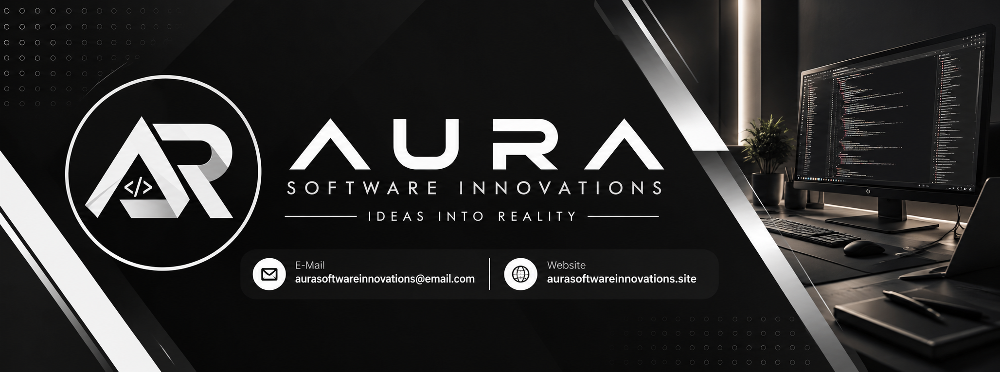

 

### Software built around real needs.

**Web · Mobile · Desktop · Game · Cloud · App Publishing**

We design, develop, and deliver custom software for businesses, startups, and individuals.

[Website](https://aurasoftwareinnovations.site) · [Email](mailto:aurasoftwareinnovations@email.com)

---

## About AURA

**AURA Software Innovations** is an independent software development team focused on building practical digital products. From a business website to a custom application or backend system, we work with clients to understand what they need, plan the right solution, and bring it to life.

We value clear communication, thoughtful design, maintainable code, and dependable support after launch.

## What We Do

| Service | What we build |
| --- | --- |
| **UI/UX Design** | Interfaces, wireframes, prototypes, and product experiences |
| **Web Development** | Business websites, web applications, dashboards, and custom platforms |
| **Mobile Development** | Android and iOS applications, cross-platform apps, and API integrations |
| **Desktop Development** | Desktop applications, internal tools, and business management systems |
| **Game Development** | 2D/3D games, gameplay features, and backend integrations |
| **Cloud & Backend** | APIs, databases, server setup, deployment, and maintenance |
| **App Publishing** | Google Play and Apple App Store release preparation and submission assistance |

## Tech Stack

We choose tools based on the project's requirements rather than forcing every project into the same stack.

**Frontend & Web**

**Backend & Data**

**Mobile, Desktop & Game**

**Infrastructure & Tools**

## How We Work

**Discuss → Plan → Design & Develop → Test → Launch & Support**

Every project is different. We discuss the scope, timeline, and budget before development begins, then keep communication straightforward throughout the work.

## Let's Connect

Have a project in mind, or need help with an existing application? We'd be happy to hear about it.

- **Website:** [aurasoftwareinnovations.site](https://aurasoftwareinnovations.site)
- **Email:** [aurasoftwareinnovations@email.com](mailto:aurasoftwareinnovations@email.com)

---

© 2026 AURA Software Innovations · Ideas Into Reality.

